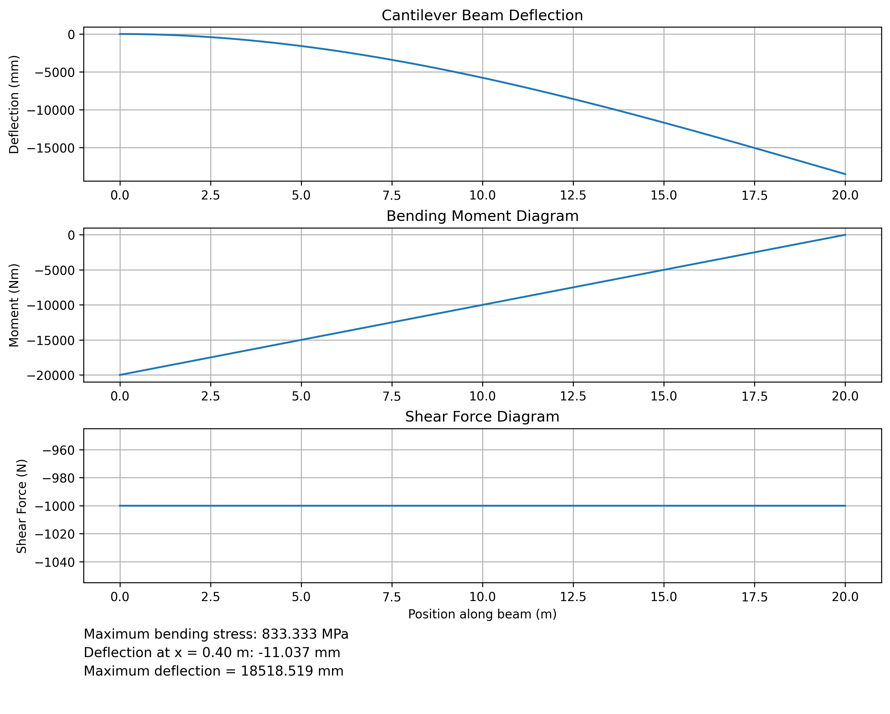

# BeamLab

A Python-based cantilever beam analysis tool for calculating and visualizing beam deflection, shear force, bending moment, and maximum bending stress.

This project was developed to apply concepts from Mechanics of Materials while practicing Python programming, numerical analysis, data visualization, and software testing.

## Features

- Calculate maximum beam deflection.
- Calculate deflection at any position along the beam.
- Generate shear force and bending moment diagrams.
- Calculate maximum bending stress.
- Display numerical results alongside engineering diagrams.
- Export analysis reports as PNG images.
- Validate user inputs.
- Run automated tests using pytest.

## Example output



## Engineering model

BeamLab currently analyzes a cantilever beam with a concentrated downward force applied at its free end.

The beam has a rectangular cross-section and is assumed to behave according to Euler-Bernoulli beam theory.

### Governing equations

**Second moment of area**

`I = bh³ / 12`

**Deflection at position x**

`v(x) = -Fx²(3L - x) / (6EI)`

**Maximum deflection**

`δ_max = FL³ / (3EI)`

**Shear force**

`V(x) = -F`

**Bending moment**

`M(x) = -F(L - x)`

**Maximum bending stress**

`σ_max = FLh / (2I)`

### Parameters

| Symbol | Description | Unit |
|---|---|---|
| F | Applied force | N |
| L | Beam length | m |
| E | Young's modulus | Pa |
| I | Second moment of area | m⁴ |
| b | Beam width | m |
| h | Beam height | m |
| x | Position along beam | m |

The fixed support is located at x = 0, and the free end is located at x = L. Downward deflection is represented by negative values.

### Assumptions

- Homogeneous, isotropic, linearly elastic material.
- Small deflections and rotations.
- Constant rectangular cross-section.
- Perfectly fixed support.
- Static loading.
- Negligible shear deformation.

## Tech stack

- Python
- NumPy
- Matplotlib
- pytest

## Installation

Clone the repository:

```bash
git clone https://github.com/mangacatbuilding/beamlab.git
cd beamlab
```

Create a virtual environment:

```bash
python3 -m venv venv
```

Activate the environment (macOS/Linux):

```bash
source venv/bin/activate
```

Install dependencies:

```bash
python -m pip install -r requirements.txt
```

## Usage

Run the program:

```bash
python beam_calculator.py
```

Enter the requested parameters:

1. Applied force (N)
2. Beam length (m)
3. Beam width (mm)
4. Beam height (mm)
5. Position from the fixed support (m)

The current model uses a fixed Young's modulus of 200 GPa.

The program generates three engineering diagrams and a summary of the calculated results.

The report is saved as `beam_analysis_report.png`.

## Example calculation

Input parameters:

| Parameter | Value |
|---|---|
| Force | 100 N |
| Length | 1 m |
| Width | 20 mm |
| Height | 30 mm |
| Young's modulus | 200 GPa |
| Selected position | 0.5 m |

Expected results:

| Result | Value |
|---|---|
| Maximum deflection | 3.704 mm |
| Deflection at 0.5 m | -1.157 mm |
| Maximum bending stress | 33.333 MPa |
| Maximum bending moment magnitude | 100 N·m |
| Internal shear force | -100 N |

## Testing

BeamLab uses pytest for automated testing of calculations, boundary conditions, input validation, and application behavior.

Run the test suite:

```bash
python -m pytest -v
```

## Project structure

```text
beamlab/
├── beam_calculator.py
├── cantilever.py
├── test_beam.py
├── requirements.txt
├── README.md
├── .gitignore
└── screenshots/
    └── beam_analysis_report.png
```

## Limitations

The current version supports only a cantilever beam subjected to a single concentrated downward load at its free end.

It does not currently support:

- Simply supported beams.
- Uniformly distributed loads.
- Multiple applied loads.
- Non-rectangular cross-sections.
- Nonlinear material behavior.
- Large deflections.
- Dynamic loading.

The tool is intended for educational purposes and is not a substitute for validated structural engineering software.

## Future improvements

Potential improvements include additional beam configurations, distributed loading conditions, customizable material properties, and an interactive user interface.

## Author

Developed by [mangacatbuilding](https://github.com/mangacatbuilding), a Mechanical and Aerospace Engineering undergraduate interested in computational engineering and software development.